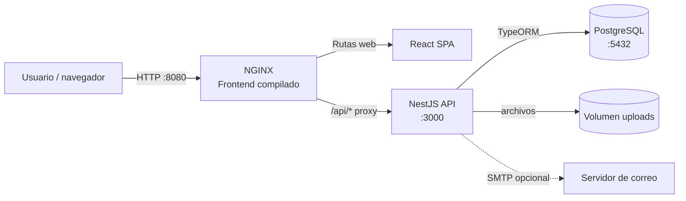

# Arquitectura de MantaLink

## Visión general

MantaLink es una aplicación web cliente-servidor organizada en tres componentes de ejecución: una interfaz React, una API REST NestJS y una base de datos PostgreSQL. En el entorno local se ejecutan como servicios independientes de Docker Compose.

La API también publica el puerto `3000` durante el desarrollo. El frontend de desarrollo usa Vite en `5173` y reenvía `/api` al backend; en Docker, NGINX sirve los recursos estáticos y reenvía `/api/` al servicio `backend`.

## Componentes

### Frontend

La aplicación de una sola página (SPA) está en `frontend/`. React y React Router renderizan las pantallas, componentes compartidos y rutas públicas o protegidas. La capa `src/api/` concentra las solicitudes HTTP y la gestión del token; las demás capas consumen sus funciones sin crear conexiones directas al backend.

### Backend

La API está en `backend/` y publica sus rutas bajo el prefijo `/api`. NestJS separa el sistema por módulos de dominio: autenticación, publicaciones, categorías, favoritos, reportes, administración, archivos, correo y contacto. Cada módulo agrupa controladores, servicios y, cuando aplica, DTO para validar las entradas.

Los controladores reciben solicitudes HTTP; los servicios implementan reglas de negocio y acceso a datos; las entidades TypeORM describen el modelo persistente. Los guards compartidos aplican autenticación y roles.

### Persistencia y archivos

PostgreSQL conserva usuarios, publicaciones, categorías, favoritos, reportes, moderaciones, calificaciones, mensajes de contacto y tokens de recuperación. TypeORM mapea las entidades y administra las migraciones.

Las imágenes subidas se guardan como archivos en el directorio configurado por `UPLOADS_DIR`, separado de la base de datos. En Docker Compose, el volumen `uploads` permite conservarlas al recrear el contenedor. La API entrega las imágenes desde `/api/archivos/:nombre`.

## Recorrido de una solicitud

1. El navegador carga la SPA desde NGINX o desde el servidor de desarrollo de Vite.
2. El cliente HTTP del frontend solicita recursos de la API bajo `/api`.
3. NGINX (Docker) o el proxy de Vite (desarrollo) reenvía la solicitud al backend.
4. NestJS aplica validación global y controles de acceso, y delega la operación al módulo correspondiente.
5. El servicio consulta o modifica PostgreSQL mediante TypeORM; las operaciones de archivos usan el almacenamiento local configurado.
6. La API devuelve JSON y el frontend actualiza la pantalla.

## Despliegue de desarrollo

`docker-compose.yml` define `db`, `backend` y `frontend`, junto con volúmenes persistentes para PostgreSQL y las fotos subidas. El servicio backend espera a que PostgreSQL pase su comprobación de salud. La imagen del frontend compila la SPA y la sirve con NGINX; la imagen del backend compila TypeScript y ejecuta el seed antes de iniciar la API.

La configuración incluida en Compose es exclusivamente para desarrollo. Para producción se deben proporcionar secretos y orígenes permitidos mediante configuración segura, además de desplegar HTTPS y servicios persistentes apropiados.
